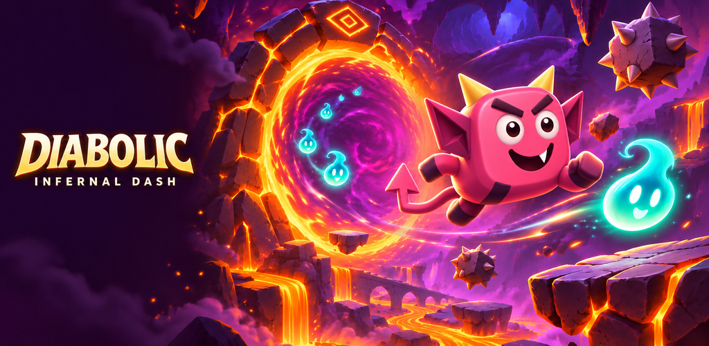
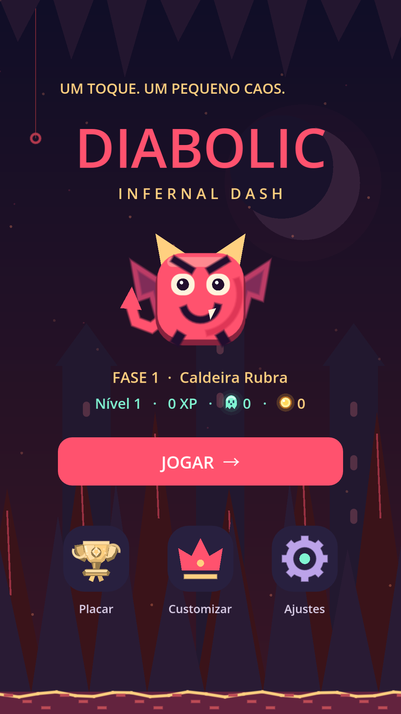
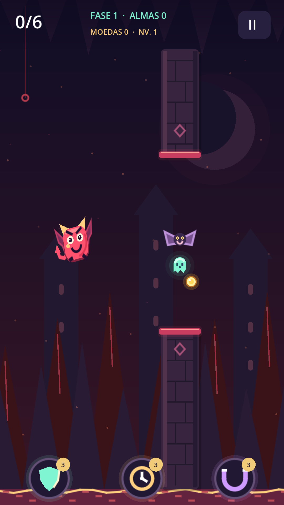

# Diabolic: Infernal Dash

**Um toque. Um pequeno caos.**

Um diabinho cheio de expressões, portais perigosos e uma aventura que sempre tem uma próxima fase. **Diabolic: Infernal Dash** é um jogo Android de arcade da **VioletTech Group**, com controle de um toque, humor e dificuldade crescente.

## Sua próxima tentativa começa aqui

- Explore uma campanha infinita com **10 mil combinações de cenários**.
- Colete almas e moedas, ganhe experiência e suba de nível.
- Use **escudo, tempo e ímã** para enfrentar perigos e inimigos.
- Escolha entre **20 diabinhos** e personalize o visual com **50 acessórios**.
- Dispute o placar e guarde sua aventura automaticamente ao entrar com Google.
- Curta sons cômicos, expressões animadas e celebrações com fogos.
- Jogue com compras opcionais e vídeos opcionais para ganhar moedas ou uma vida extra.

<table><tr><td></td><td></td></tr></table>

## Disponibilidade

**Versão 0.7.26 — teste fechado na Google Play**, aprovada em 6 de novembro de 2026. O lançamento público ainda depende das etapas obrigatórias da loja. Enquanto isso, o acesso pode exigir participação autorizada no teste.

[Ver na Google Play](https://play.google.com/store/apps/details?id=com.diabolic.infernaldash)

## Feito com

Godot e GDScript no jogo; Java na integração Android; Laravel/PHP nos serviços; Firebase para conta e progresso; Google Play Billing para compras e Unity LevelPlay/Unity Ads para vídeos opcionais.

A identidade combina cavernas escuras, lava, almas luminosas e personagens cômicos. As imagens acima são materiais de apresentação do projeto.

## VioletTech Group

- [Política de privacidade](https://diabolic.minha.bio.br/privacy.html)
- [Solicitar exclusão de conta](https://diabolic.minha.bio.br/delete-account.html)
- Contato: violettech.group@gmail.com

Este repositório apresenta o projeto. O código-fonte não é distribuído aqui. Marca e imagens permanecem protegidas pelos direitos de seus titulares.
